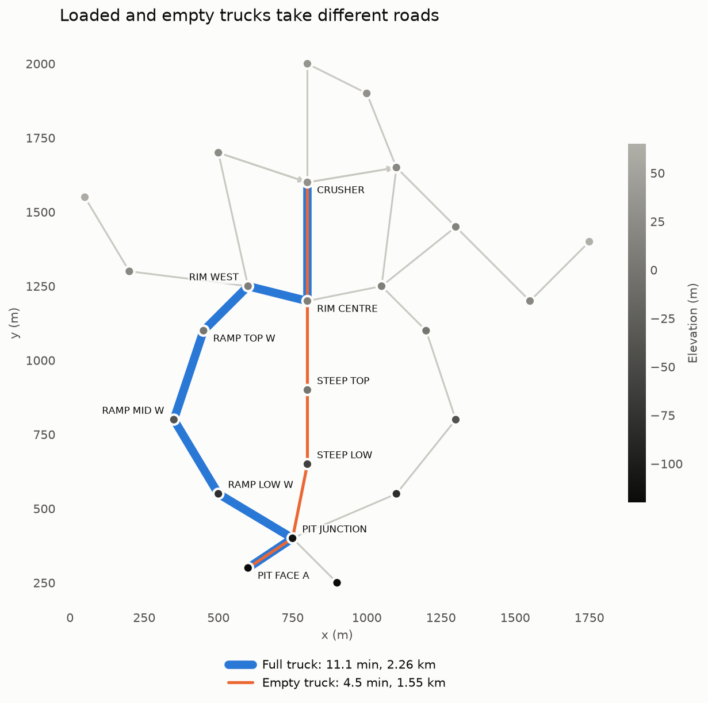
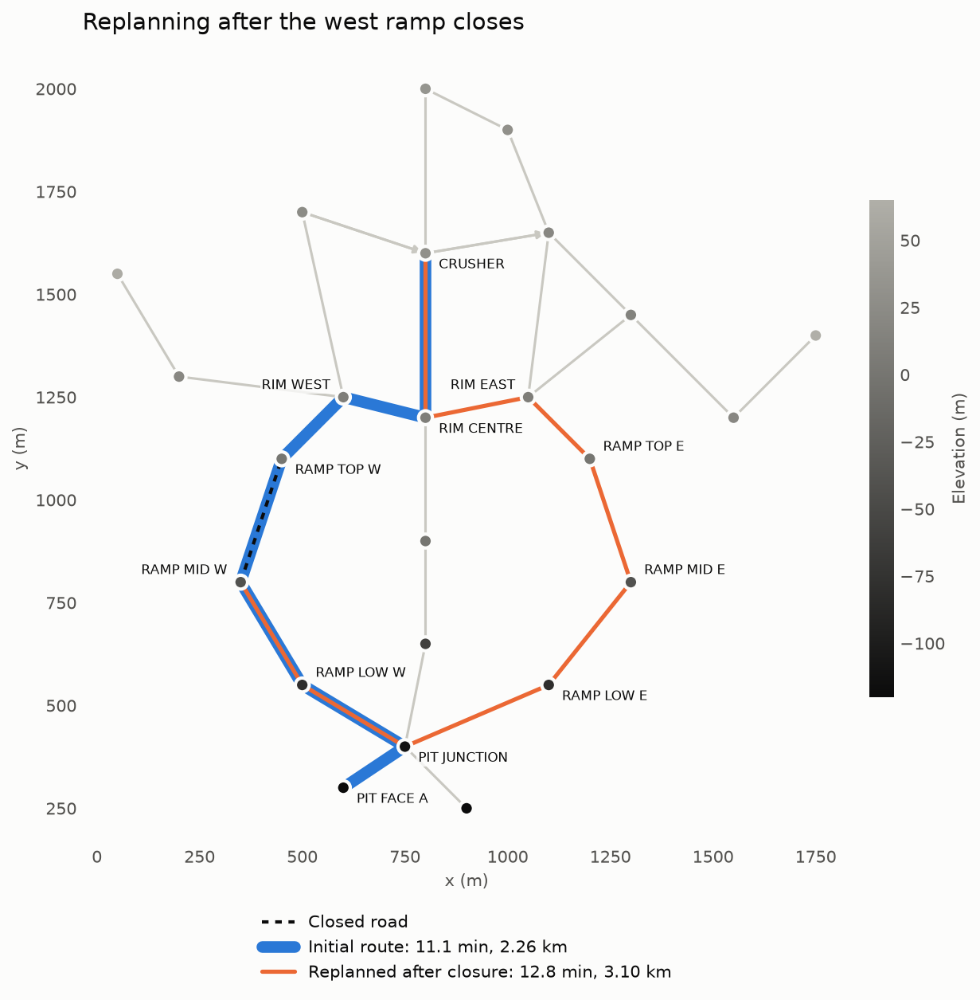

# Mine Haul Routing

Finds the fastest route for a haul truck across an open-pit mine, in C11 with no
runtime dependencies. Routes account for road length, slope and whether the truck
is loaded, and can be replanned from the truck's current position when a road
closes. Dijkstra and A* share one search loop and a hand-written binary heap.
Python reads the JSON output and draws the map.

A loaded truck and an empty truck take different roads out of the same pit. The
service ramp is short but past a loaded truck's traction limit, so the loaded
truck takes the longer west ramp:



When the west ramp closes with the truck halfway up, it turns back and takes the
east ramp:



## Tech stack

| Part | Choice |
|---|---|
| Core | C11, built with `-Wall -Wextra -Werror -pedantic` |
| Build | GNU Make |
| Tests | A small assertion header written for this project, plus a POSIX shell script for the CLI |
| Memory checks | Valgrind: any leak or memory error fails the build |
| Plots | Python 3.12 and matplotlib, which only read the JSON |
| CI | GitHub Actions |

## Running it

On Ubuntu, or WSL2 on Windows, because Valgrind does not run on Windows:

```bash
sudo apt install build-essential valgrind
make
./build/mine-route --map data/sample_mine.road --from PIT_FACE_A --to CRUSHER --load full
```

Replan after a closure, with the truck at `RAMP_MID_W`:

```bash
./build/mine-route --map data/sample_mine.road --from PIT_FACE_A --to CRUSHER \
    --close RAMP_MID_W,RAMP_TOP_W --at RAMP_MID_W --output route.json
```

| Command | What it does |
|---|---|
| `make test` | Unit tests and CLI scenarios |
| `make valgrind` | The same, under Valgrind |
| `make bench` | Generates large maps and writes `bench/results.json` |
| `make demo` | Writes the JSON behind the figures to `build/demo/` |

To redraw the figures from `make demo`'s output:

```bash
python -m venv .venv
.venv/bin/pip install -r viz/requirements.txt
.venv/bin/python viz/plot_route.py --title "Loaded and empty trucks take different roads" \
    --output docs/route_load_comparison.png build/demo/full.json build/demo/empty.json
.venv/bin/python viz/plot_route.py --title "Replanning after the west ramp closes" \
    --output docs/route_closure.png build/demo/closure.json
```

## Road network format

Plain text, one record per line. `#` starts a comment.

```text
# N id name x_m y_m elevation_m
N 0 PIT_A 120.0 40.0 -85
N 1 CRUSHER 300.0 210.0 12
# E from to length_m speed_limit_kmh one_way closed
E 0 1 450 40 0 0
```

Errors give the file and line, such as `map.road:12: length_m must be greater than 0, got '-5'`.

## Cost model

The cost of a road is the **time** to drive it, because time is what a mine cares
about and it puts distance, slope and load in one unit. Speed is the lowest of:

| Limit | Rule |
|---|---|
| Road and truck | The road's speed limit, and a 60 km/h top speed |
| Engine power | `v = P / (m * g * (grade + rolling resistance))` |
| Traction | Past the force the wheels can deliver, the truck crawls at 4 km/h |
| Braking | Downhill, the safe speed falls with the slope, and faster when loaded |

The vehicle figures (250 t full, 100 t empty, 800 kW at the wheels, 450 kN of
traction) are round numbers of a plausible size. **They are assumptions, not a
manufacturer's specification.**

## Design decisions

**Why the traction limit exists.** With the power limit alone, climb time depends
mostly on height gained, so the shortest ramp always wins and load never changes
the route. Traction is what makes a steep ramp a bad choice for a loaded truck only.

**One search loop for both algorithms.** Priority is cost so far plus a heuristic.
With the heuristic off, that is exactly Dijkstra, so a fix to one applies to both
and the speed comparison measures only the heuristic.

**The A\* heuristic is straight-line distance over the top speed for that load.**
It never overestimates, provided no road is shorter than the straight line between
its ends, so the road file parser rejects any road that is. Without that check, one
bad data point could silently make A\* return a worse route.

**Indexed heap with decrease-key.** A position table finds any queued node in O(1).
The common alternative is to push duplicates and skip stale entries when popped,
which needs no table but lets the heap grow to O(E). I did not measure which is
faster here.

**Adjacency list as one dynamic array per node, with node ids as array indices.**
Search spends most of its time scanning arcs, and contiguous memory suits the cache.
The cost is that ids in the file must count up from 0.

**Closed roads stay in the graph as a flag,** so reopening one is a single write.
Closing a road closes every arc between its two nodes, in both directions, because
a closure blocks the physical road.

**The top speed is computed once per map and includes closed roads.** It stays valid
after a closure, and the O(E) scan is not repeated for every search.

## Complexity

With V nodes and E arcs, each search takes O((V + E) log V) time and O(V) memory.
The search stops when the destination leaves the queue. Heap insert, pop and
decrease-key are O(log V). Both algorithms have the same worst case, so A\*'s
advantage only shows up in practice.

## Speed comparison

200 random start and destination pairs per row, on generated grid maps. Each time
is the mean per query, from the median of 5 passes. The run fails if the two
algorithms ever disagree on a cost.

| Nodes | Load | Dijkstra (ms) | A* (ms) | Time saved | Dijkstra expanded | A* expanded | Expansions saved |
|---|---|--:|--:|--:|--:|--:|--:|
| 10,000 | empty | 1.03 | 0.70 | 31% | 4,780 | 2,883 | 40% |
| 10,000 | full | 0.61 | 0.50 | 18% | 4,753 | 3,478 | 27% |
| 40,000 | empty | 3.81 | 2.82 | 26% | 21,824 | 13,632 | 38% |
| 40,000 | full | 4.44 | 3.47 | 22% | 21,899 | 16,435 | 25% |
| 90,000 | empty | 11.66 | 6.41 | 45% | 45,485 | 27,242 | 40% |
| 90,000 | full | 11.87 | 7.24 | 39% | 45,407 | 32,894 | 28% |

Measured once with `make bench` (`-O2`) on an Intel i7-13700H laptop, in WSL2 on
Ubuntu 26.04 with gcc 15.2. Treat the times as a rough guide: the 10,000-node rows
differ by more than their expansion counts explain, so they include noise. The
expansion counts come from the search itself and do not vary with the machine.

A\* saves less for a loaded truck, probably because its heuristic is further from
reality: a loaded truck reaches 56 km/h on a gentle descent but is far slower on most
roads, so straight-line distance over top speed underestimates the remaining time by
more. I inferred this from the results and did not test it separately.

## Testing

- 88 C unit tests and 30 CLI scenarios, all also run under Valgrind.
- A\* is checked against Dijkstra on 1000 random pairs for each load. Costs must be
  exactly equal, and every route is checked to be drivable and to cost what it claims.
- The heap is checked against sorted output and against a brute-force model over
  20,000 random operations.
- During development I also deliberately broke the code to confirm the tests noticed,
  simulated each allocation failing, and ran AddressSanitizer and UBSan. These were
  one-off checks and are not part of CI.

## Known limitations

- **No real mine data.** The sample mine is designed by hand, and the speed tests use
  generated grids, so the savings may differ on a real road network.
- **The physics is simplified.** Speed is constant along a road: there is no
  acceleration, gear curve, traffic, queueing at the crusher, or turning cost.
- **One truck at a time.** Trucks do not interact.
- **Replanning is a full new search.** An incremental algorithm such as D\* Lite could
  reuse earlier work, which this project does not attempt.
- **Each search allocates and fills O(V) arrays,** even when it expands few nodes. This
  narrows A\*'s lead on short trips; reusable buffers would help.
- **Names cannot contain spaces,** and a line is limited to 1022 characters.
